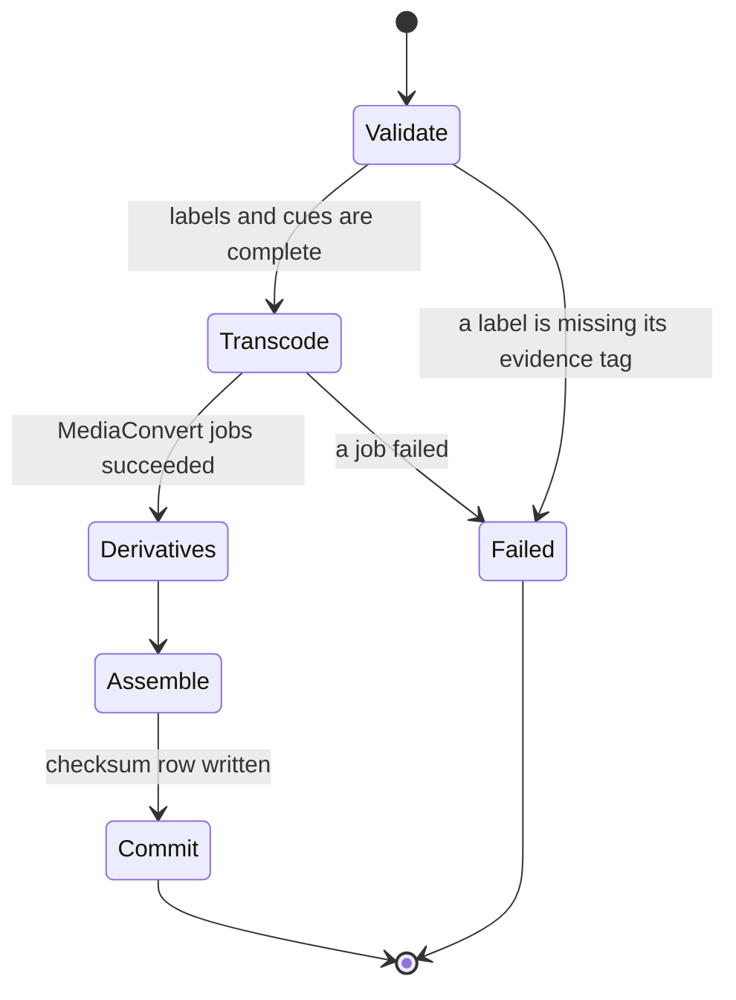

# Odyssey on AWS

November 2026. This is the production architecture. The field client plays a pack that AWS has built and signed. Until the first publish succeeds, no visitor URL is issued. The stacks below are what gets stood up, not a menu of optional vendors.

Home region is `eu-central-1`. One account. Infrastructure is AWS CDK. A change to the system is a change to a stack, not a server someone SSH-es into.

The design system is [tasarim_kurallari.md](tasarim_kurallari.md). This document does not repeat the color table.

## 1. The split

AWS owns every byte until the phone has verified the pack.

| On AWS | On the phone, after the checksum |
| --- | --- |
| Masters, transcodes, resized photographs | The verified pack directory |
| The catalog and the current-version pointer | Ready flag, download progress, playback position |
| Accounts and entitlements | Nothing that identifies another visitor |
| Signed download URLs | The walk itself |

Field mode, the stop screen, and the label sheet do not call AWS. If the process is killed, the client returns to the last stop with the narration paused. It does not resume audibly by itself, and it does not ask the catalog whether it may continue.

## 2. Stacks

Four CDK stacks, in one account. They share a KMS key and almost nothing else.

| Stack | Creates |
| --- | --- |
| `Identity` | Amazon Cognito user pool and app client |
| `Data` | Amazon DynamoDB tables, the customer-managed KMS key |
| `Media` | Private masters bucket, MediaConvert role, AWS Step Functions, builder Lambdas, Amazon SNS topic for a failed publish |
| `Delivery` | Pack bucket, Amazon CloudFront with origin access control, AWS WAF, AWS Certificate Manager certificate, Amazon API Gateway HTTP API, catalog Lambdas, the CloudFront signing key in AWS Secrets Manager |

`Delivery` reads the current-version pointer. It cannot write a pack. `Media` can write the next version prefix. It cannot move the pointer until the checksum row exists. That split is IAM, not a convention.

## 3. Services

| Service | Role | Why this one |
| --- | --- | --- |
| Amazon S3 | Three buckets: masters, packs, previews. Block public access. Versioning on the masters bucket. | The source of a correction has to outlive the correction. The phone never learns the masters bucket's name. |
| Amazon CloudFront | The only public front for bytes. Origin access control. HTTP range. Signed URLs. HTTPS only. | Visitors download the night before a trip, far from Frankfurt. The field does not hit an origin. |
| AWS WAF | On the distribution and on the API. Rate-limit the signing route. | A leaked client should not be able to mint URLs in a loop. |
| AWS Elemental MediaConvert | Wav master to AAC in an m4a container, one loudness target for every stop. | Level jumps between stops are a field bug. Transcode is a job, not a warm server. |
| AWS Step Functions | One Standard workflow, `PublishPack`. | A transcode can run longer than an Express execution. Standard is the one that can wait for MediaConvert. |
| Amazon EventBridge | Starts a publish from the API, and routes a failed execution to the alarm. | The editor's button and the operator's alarm are events, not a poll. |
| AWS Lambda | Validate, image derivatives, assemble the manifest, sign a download, catalog reads. | These run when something happens. None of them run while someone is standing at a façade. |
| Amazon API Gateway | HTTP API. Catalog, signed download, entitlement webhook, start-publish. | One front door and one authorization story. |
| Amazon DynamoDB | Destinations, pack heads, entitlements, builds. On-demand. Point-in-time recovery. | A few rows per destination, read on each catalog call, written when we publish. Not a session store for the field. |
| Amazon Cognito | The account, when an account exists. The app uses the identity SDK. | We do not operate a password database. |
| AWS KMS | One customer-managed key for the buckets, the tables, and Secrets Manager. | SSE-S3 is not enough once a signing key and entitlements share the account. |
| AWS Secrets Manager | The CloudFront private key, and the webhook secret from the payment provider. | Lambda reads them at runtime. They are not in the pack and not in this repository. |
| AWS Certificate Manager | The certificate on the distribution. | HTTPS only, issued and renewed in AWS. |
| Amazon SNS | One topic. A failed `PublishPack` execution notifies the editor. | The visitor never sees this topic. |
| Amazon CloudWatch | Logs, metrics, alarms. | A pack that cannot be built has to reach a person. |
| AWS X-Ray | Traces on the HTTP API and on the state machine. | A slow sign-url call should be a trace, not a guess. |
| IAM | Three roles: editor, builder, catalog. No shared long-lived key that can publish. | The pointer move is a permission, not a code comment. |
| AWS CDK | The four stacks. | The architecture in this file is what the stacks implement. |

Not in the account, on purpose: Amazon EKS, Amazon ECS, Amazon OpenSearch, AWS IoT, Amazon Location Service, a second region "for the diagram," and any service whose job is to watch a visitor's position. Download bytes and MediaConvert minutes are the cost. The catalog's request volume is noise next to those two.

The payment provider is the one system outside AWS. It confirms a charge to API Gateway. From that request on, the grant is a DynamoDB row. The provider is not named in this repository, and its keys live in Secrets Manager.

## 4. S3

```text
s3://odyssey-masters/         private, no CloudFront
  {destinationId}/{stopId}/master.wav
  {destinationId}/{stopId}/source/{photo}

s3://odyssey-packs/           private, CloudFront origin access control
  {destinationId}/{version}/manifest.json
  {destinationId}/{version}/audio/{stopId}.m4a
  {destinationId}/{version}/images/...
  {destinationId}/{version}/labels/...
  {destinationId}/{version}/route.geojson

s3://odyssey-previews/        private, same distribution, separate path
  {destinationId}/{version}/preview.m4a
```

Bucket names in the account will carry the account's prefix. The shape is this. Public access blocks are on. There is no S3 website endpoint.

Masters use versioning. Packs are immutable prefixes: a new integer, a new prefix, never an overwrite of a version a phone might already be checking. Lifecycle rules do one thing: abort incomplete multipart uploads. They do not expire old pack versions. Expiring version 3 would strand a phone that recorded version 3.

Pack objects are Standard. They are downloaded soon, often once, in full. Masters stay Standard as well until a destination is retired. Glacier would make a correction wait on a restore, which is the wrong trade for a short catalog of walks.

## 5. The pack

`manifest.json` is the only file the client needs in order to know the pack is complete. Anything not named there is not part of the walk.

The identifiers below are illustrative. They are not a published destination.

```json
{
  "destinationId": "example-site",
  "version": 3,
  "locale": "tr",
  "title": "Example Site",
  "checksum": "sha256-of-this-manifest-payload",
  "route": "route.geojson",
  "stops": [
    {
      "id": "stop-04",
      "title": "Durak 4",
      "audio": "audio/stop-04.m4a",
      "durationSec": 240,
      "hero": "images/stop-04-hero.jpg",
      "markers": [
        {
          "n": 1,
          "x": 0.42,
          "y": 0.31,
          "cue": [48, 110],
          "label": "labels/stop-04-marker-1.json"
        }
      ]
    }
  ]
}
```

`x` and `y` are fractions of the hero image. `cue` is a half-open range, in seconds, of that stop's single narration. Ranges on one stop do not overlap. `title` is the route position («Durak 4»). `n` is the number painted on the photograph. They are different series, in different fields.

A label document is JSON: `title`, `body`, `evidence` (`supported`, `possible`, or `interpretation`), `basis`, `sources`. The Turkish interface renders those as Kanıtlı, Olası, and Yorum. The label has no audio file. A client that finds one ignores it.

`route.geojson` is one LineString and one Point per stop, in walk order. It is the curated path. The first release does not record GPS. "Nearby" is a status line when the device already has a fix. It is not a trigger, and it is not an Amazon Location Service call.

Speech is AAC, loudness-normalized in MediaConvert, so stops sit at one level. Photographs are resized for a phone. Camera originals and wav masters stay in the masters bucket and are not in the download.

## 6. PublishPack

`POST /destinations/{id}/publishes` on API Gateway starts one Standard execution. The editor is authenticated. The Lambda that starts the execution does not copy media itself.



1. **Validate.** Lambda checks that every stop has one audio master, a hero, and labels whose `evidence` and `basis` are present. It cannot check that they are true. A person accepts the historical claim before this call. The state machine does not skip that.
2. **Transcode.** The Step Functions service integration runs MediaConvert and waits. Outputs land in a build prefix of the pack bucket, not in the version prefix yet.
3. **Derivatives.** Lambda writes resized images beside the m4a files.
4. **Assemble.** Lambda writes `manifest.json`, the per-file sha256 table, and the route. It writes a DynamoDB build row that is not current.
5. **Commit.** A conditional update moves `currentVersion` to the new integer. Two publishes serialize on that row.
6. **Failed.** EventBridge sees the execution failure. SNS notifies the editor. `currentVersion` does not move.

CloudFront does not need an invalidation of the media. The path contains the version. The catalog response is the only cache that ages, and its TTL is short.

A visitor mid-download of version 3 keeps downloading version 3 when version 4 becomes current. The next acquisition sees 4. The ready pack stays 3 until the visitor replaces it.

## 7. Catalog and download

`GET /destinations` returns what Keşfet renders: identity, title, region, approximate duration, latest version, byte size, and whether a preview exists. It does not return label bodies. Those live in the pack.

`GET /destinations/{id}/download` returns a descriptor: version, byte size, sha256, and a CloudFront URL that expires in minutes. The catalog Lambda signs it with the key in Secrets Manager. The URL is refused without an entitlement row, or without the destination's free flag.

CloudFront serves the versioned prefix with HTTP range, so a dropped hotel network continues. Revoking future downloads is "stop signing." It does not reach into a phone that already verified the file. Removing a pack from a device is a local delete.

A preview, when one exists, is its own object and its own short manifest under `odyssey-previews`. It does not contain the full label set, it does not start by itself, and it does not unlock field mode.

## 8. DynamoDB

On-demand capacity. Encryption with the customer-managed key. Point-in-time recovery on.

| Table | Key | Holds |
| --- | --- | --- |
| `destinations` | `destinationId` | Title, region, locale, approximate duration, free flag |
| `pack_heads` | `destinationId` | `currentVersion`, checksum, byte size, updated at |
| `builds` | `destinationId` + `version` | Status, per-file checksums, execution ARN. Not readable by the catalog role until status is committed. |
| `entitlements` | `accountId` + `destinationId` | The grant: this account, this destination, "current" or a pinned version |

The catalog role can read `destinations`, `pack_heads`, and `entitlements`. It cannot read `builds` in a non-committed status, and it cannot write a pack. The builder role can write `builds` and, only in the Commit state, update `pack_heads` with a condition that the version is exactly one greater than current.

## 9. Identity

Account is an avatar page, not a tab, because the walk does not need one. When it exists, it is a Cognito user pool. The React Native client (Expo) uses the Cognito identity SDK. There is no parallel user table to migrate later.

The first destinations can be acquired without an account, by the free flag. A paid destination waits for the provider's confirmation, then the entitlement row. Restoring on a second device is "list my entitlements and download what this phone does not have." It is not a stream, and it is not required to press play on a pack that is already verified.

Cognito sends its own mail for sign-up and password reset at the start. Amazon SES is added only if that volume outgrows Cognito's mail. It is not a second product path.

## 10. IAM

| Role | Can | Cannot |
| --- | --- | --- |
| Editor | Put masters. Call `POST .../publishes`. | Move `currentVersion` by hand. Read the CloudFront signing key. |
| Builder | Read masters. Write the next pack prefix. Write the build row. Update `pack_heads` only with the version condition. | Delete an older version. Sign a visitor URL. |
| Catalog | Read destinations, heads, entitlements. Sign a URL for a current or entitled version. | Read the masters bucket. Write a pack. Read Secrets Manager beyond the signing key. |

No laptop holds a key that can do all three. A developer profile can synthesize and read logs. It cannot publish.

## 11. Encryption and TLS

One KMS key, rotation on, used by the three buckets, the four tables, and Secrets Manager. The CloudFront public key sits in a trusted key group. The private key is a secret, read by the catalog Lambda, never written into an environment variable in the repository.

ACM terminates TLS on the distribution. The API is HTTPS only. The masters bucket has no distribution in front of it.

Object keys are not an access policy. Access is the bucket policy, origin access control, and the signature.

## 12. The client, where it touches AWS

The field client is React Native, Expo, iOS and Android. It touches AWS in three places, all before or beside the walk:

1. Cognito, if the visitor signs in.
2. API Gateway, for the catalog and for a signed URL.
3. CloudFront, for the bytes. Range requests. Then the checksum. Then Ready.

Playback position is local in the first release. Remembering it on another phone is a later write to DynamoDB, and it never blocks play on the phone that has the file.

A missing photograph inside a verified pack is a flat frame and the title. A missing audio file disables Dinle and leaves the labels usable. A checksum mismatch is not a partial walk: the version is not marked ready, and the visitor is offered a retry of the same object.

## 13. Observability

Alarms, all in CloudWatch:

- MediaConvert job error, via the state machine
- `PublishPack` execution failed or timed out
- API Gateway 5xx
- A rise in signature failures on the download route
- CloudFront origin 4xx or 5xx for a version the catalog is currently issuing

X-Ray is on the HTTP API and the state machine. It is not on the phone during field mode.

We do not alarm on "no playback heartbeats." Silence from the field is the product working. A chart of concurrent listeners would require the phone to call home from the site. That beacon is not part of this architecture.

The two numbers that matter for capacity are pack bytes transferred, by destination and version, and MediaConvert minutes per publish.

## 14. Failure, as the visitor sees it

| What broke | What the visitor sees | What AWS did |
| --- | --- | --- |
| The network drops mid-download | Progress pauses, then continues | CloudFront range, same version prefix |
| Checksum fails | «Paket doğrulanamadı» and a retry | Pointer unchanged. Version not ready. |
| Catalog unreachable, pack ready | The walk is unaffected | The phone does not ask |
| Catalog unreachable, nothing downloaded | The last catalog response, or an empty state | No synthetic destinations |
| `PublishPack` fails | Nothing. They still have the previous version, or they download it | SNS to the editor. `currentVersion` stays. |
| Photograph missing inside a good checksum | Flat frame, title still there | Should be rare: the checksum listed the file |

## 15. Phases

**Phase 1.** The four stacks in `eu-central-1`. One or two destinations. Done means a verified pack and a full walk with the radio off. No visitor URL exists before the first Commit state succeeds.

**Phase 2.** Cognito in the path of paid destinations, entitlement webhook, restore on a second device, preview objects. SES only if Cognito mail is no longer enough.

**Phase 3.** The same pack as a teaching unit: a class or a guide reopens stops, labels, and evidence tags. If AWS needs anything new, it is a flag on `destinations`, not a parallel pipeline.

A phase does not add a service that its own paragraph does not name.

## 16. Non-goals

- Streaming the narration from the site. The file is local.
- Live GPS triggers, geofenced autoplay, and Amazon Location Service as a way to start audio.
- A visitor-uploaded route.
- Transcoding on the phone.
- A public S3 website, an open bucket, or a pack URL that does not expire.
- A second cloud, a Kubernetes cluster, or a long-running encoder.
- Reusing another product's account system or content database. Odyssey has its own Cognito pool, its own tables, and its own buckets.

## 17. Repository boundary

This repository holds the design system and this architecture. The CDK stacks, the Lambda handlers, and the client land here as they become real, in that order of usefulness to a visitor. Stack definitions contain no secrets.

Sample manifests in tests use the shape in section 5 and fictional content. Narration scripts, research notes, and photography do not get added so the repository looks fuller. They stay in the masters bucket, which is not public.
