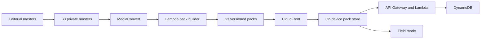
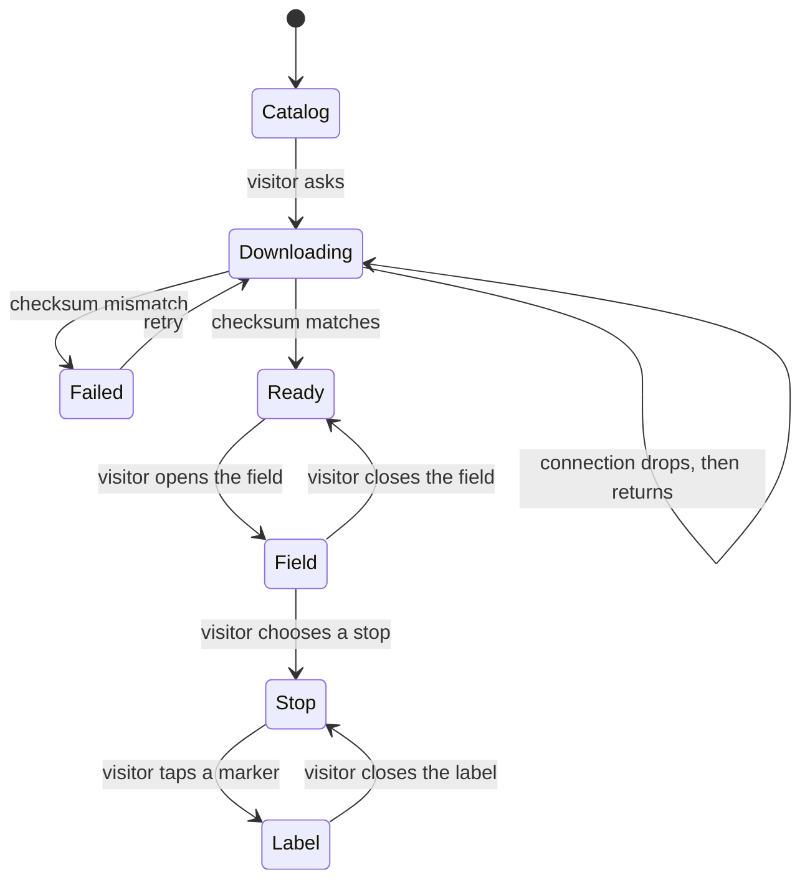

# Odyssey architecture

November 2026. This is the target architecture for the first destination, not a claim that every service is already provisioned. The client and the pack pipeline are the build. The shapes below are what they are being built toward.

The design system that the client has to obey is [tasarim_kurallari.md](tasarim_kurallari.md). This document does not repeat the color table. It describes how a pack is made, stored, delivered, and played when the radio is off.

## 1. What the system has to guarantee

1. After a pack is marked ready, field mode makes no network call in order to play, to open a label, or to draw the route.
2. A pack is immutable. A correction is a new version, not an overwrite of the bytes a visitor already verified.
3. The catalog may be stale. The pack on disk may not. Playback never waits for the catalog.
4. Masters never sit in a public bucket. The thing CloudFront serves is a built pack, or a short preview, behind a decision we can revoke.
5. A failed checksum never becomes a ready pack.

These five rules are the filter for every later service. A component that needs a socket open during a stop does not belong in field mode.

## 2. Context



Two stores, on purpose. The private bucket holds wav masters, original photographs, and the editorial source of a label. The pack bucket holds the object the phone is allowed to see: compressed audio, resized photographs, a manifest, and label documents. The phone never receives the private bucket's name.

## 3. The pack

A destination pack is one curated walk. It is a versioned object, addressed as `packs/{destinationId}/{version}/`. The version is an integer that only increases.

### 3.1 Layout

```text
manifest.json
audio/stop-04.m4a
images/stop-04-hero.jpg
images/stop-04-marker-1.jpg
labels/stop-04-marker-1.json
route.geojson
```

`manifest.json` is the only file the client has to understand in order to decide that the pack is complete. Everything else is named by the manifest. A file that is not in the manifest is not part of the walk, even if it was uploaded beside it.

### 3.2 Manifest, structural example

The identifiers below are illustrative. They are not a published destination.

```json
{
  "destinationId": "example-site",
  "version": 3,
  "locale": "tr",
  "title": "Example Site",
  "checksum": "sha256-of-this-manifest-payload",
  "route": "route.geojson",
  "stops": [
    {
      "id": "stop-04",
      "title": "Durak 4",
      "audio": "audio/stop-04.m4a",
      "durationSec": 240,
      "hero": "images/stop-04-hero.jpg",
      "markers": [
        {
          "n": 1,
          "x": 0.42,
          "y": 0.31,
          "cue": [48, 110],
          "label": "labels/stop-04-marker-1.json"
        }
      ]
    }
  ]
}
```

`x` and `y` are fractions of the hero image, origin at the top left. The client converts them to the view it actually has. Pixel coordinates do not ship, because the photograph has more than one derivative.

`cue` is a half-open range in seconds of that stop's single narration. While playback time is inside the range, the matching marker is the active one. Ranges on one stop do not overlap. A marker without a cue is legal: it can be opened by touch and the narration does not point at it. The reverse is not the product. We do not point at a photograph we refuse to open.

`title` on the stop is the route position, in words the interface already uses («Durak 4»). The integers painted on the photograph are `n`. They are a different series. The manifest keeps them in different fields so a client cannot accidentally draw one as the other.

### 3.3 Label document

```json
{
  "title": "Short object title",
  "body": "Museum-label length. No script of the narration.",
  "evidence": "supported",
  "basis": "One sentence on why the tag is what it is.",
  "sources": ["Short citation, not a file from the private bucket"]
}
```

`evidence` is one of `supported`, `possible`, `interpretation`. The Turkish interface renders those as Kanıtlı, Olası, and Yorum. The tag is the weakest claim in `body`. `basis` is the Dayanak line. `sources` is the bibliography, long enough to find the publication, short enough for a phone.

The label does not contain a second audio file. A client that finds one ignores it.

### 3.4 Route file

GeoJSON, one LineString, one Point per stop, in walk order. Coordinates are the curated path, not a live trace from a visitor's phone. The first release does not record GPS. "Nearby" is allowed only when the device already has a fix and the visitor has the pack. It is a status line. It is not a trigger.

### 3.5 Size

Narration is speech, encoded as AAC in an m4a container, loudness-normalized so stops sit at one level. Photographs are resized for a phone screen, not shipped as camera originals. A walk is a few dozen minutes of speech plus a handful of photographs per stop. The budget is practical: the pack finishes on ordinary broadband before the visit, including from a hotel the night before. Camera originals and wav masters stay in the private bucket and are not in this sum.

## 4. Client

The field client is a React Native application, built with Expo, for iOS and Android. The design system is mobile-first. A desktop site is not the field product.

On the device:

| Store | Holds | Does not hold |
| --- | --- | --- |
| Pack directory | The verified version of one or more destinations | Masters, other visitors, payment instruments |
| Small local record | Ready flag, download progress, playback position, which version is on disk | A second copy of the label text |

Playback position is local in the first release. Remembering a position across phones is an account feature, later, and it never blocks playback on the phone that already has the file.

### 4.1 States



`Ready` is the only door into `Field`. `Downloading` and `Failed` are visible in Çantam. Leaving the download screen does not cancel the download. Cancelling is an explicit control.

Nothing in `Field`, `Stop`, or `Label` calls the catalog. If the process was killed, the client returns to the last stop with the narration paused at the stored position. It does not resume audibly by itself.

### 4.2 Missing pieces

A missing photograph is a flat surface and the label title. A missing audio file disables Dinle and leaves the labels usable. A missing manifest, or a checksum mismatch, is not a partial walk. The version is deleted or kept only as an incomplete download, and it is not marked ready.

## 5. Online services

The online side is a catalog and a file delivery system. It is not in the path of the narration.

### 5.1 Catalog

`GET /destinations` returns the list Keşfet renders: identity, title, region, approximate duration, latest pack version, pack byte size, and whether a preview exists. It does not return label bodies. Label bodies live in the pack.

`GET /destinations/{id}` returns the same record plus the download descriptor: object key, version, byte size, sha256, and a URL that expires.

The catalog is cacheable. The client may show the last successful response when the network is gone, with the time of that response in a secondary line. It may not treat that cache as permission to invent a pack that was never downloaded.

### 5.2 Download

CloudFront serves the versioned prefix. Requests use HTTP range, so a dropped hotel network continues rather than starting over. The URL is signed and short-lived. The bytes are not secret in the literary sense — a guide is meant to be heard — but they are not an open bucket. A signed URL lets us stop issuing new downloads without breaking a pack that is already verified on a device. Revocation of an already downloaded pack is a local delete, not a remote kill switch. We do not build a mechanism that reaches into a phone in airplane mode.

### 5.3 Entitlement

The first destinations can be acquired without an account. When a destination is paid, the sequence is:

1. A payment provider confirms the charge to our API. The provider is not named here and its keys are not in this repository.
2. The API writes an entitlement: this account, this destination, this pack version or "current".
3. The catalog refuses a signed URL without that row, or without an anonymous free flag on the destination.
4. The device downloads, verifies, and from then on does not ask again in order to play.

Restoring purchases is "list my entitlements and download the versions I am missing." It is not a stream.

### 5.4 Accounts

Account is an avatar page, not a tab, because the walk does not need one. Amazon Cognito is the intended home for the account when it exists. The first field release does not block on it. We will not invent a parallel user table "for now" and migrate later.

### 5.5 Preview

A preview, if the destination has one, is a short audio object with its own signed URL and its own small manifest. It does not contain the full label set. Preview playback uses the same player and the same rule: it does not start by itself, and it does not unlock field mode.

## 6. AWS, service by service

Home region is `eu-central-1`. Visitors are often elsewhere when they download, the night before a trip. The edge is CloudFront. We do not run the application in two regions to look distributed. A second region is a copy of the pack bucket, later, if a single region fails a download window often enough to measure. It is not part of the first build.

| Service | Role | Why this, and not a larger design |
| --- | --- | --- |
| Amazon S3, masters | Wav, camera originals, editorial source. Block public access. Versioning on. | The source of a correction has to survive the correction. |
| Amazon S3, packs | Immutable version prefixes. Lifecycle only on aborted multipart uploads. | A lifecycle rule that expires old pack versions would strand a phone that already recorded that version number. Old versions stay until we deliberately retire them. |
| Amazon CloudFront | Pack and preview distribution, HTTP range, signed URLs, HTTPS only. | Downloads happen far from Frankfurt, once, in a hurry. The field itself should not be hitting an origin. |
| AWS Elemental MediaConvert | Wav master to AAC m4a, one loudness target for every stop. | Speech that changes level from stop to stop is a field bug, not a preference. Transcode is a job, not a server we keep warm. |
| AWS Lambda | Pack builder. Image derivatives. Catalog handlers. Signing the download. | The builder runs when an editor publishes a version. It does not run while someone is standing at a façade. |
| Amazon API Gateway | The catalog and the entitlement webhook. | One front door, the same authorization story for every route. |
| Amazon DynamoDB | Destination records, current version pointer, entitlements, build status. On-demand capacity. | The catalog is a few rows per destination, read often, written when we publish. It is not a session store for field mode. |
| Amazon Cognito | Accounts, later. | We do not operate a password database. |
| Amazon CloudWatch | Build failures, transcode failures, 4xx and 5xx on the catalog, origin errors. | A pack that cannot be built has to page a person. A stop that played offline will not appear here, and that absence is correct. |
| Amazon EventBridge | "Transcode finished" starts the builder. "Builder finished" moves the current-version pointer. | The pointer moves last, after the checksum is written. Clients never see a version whose bytes are half there. |

Services we are not adopting in order to fill a diagram: a Kubernetes cluster, a search engine, a data warehouse, a realtime multiplayer layer, AWS IoT, and any service whose job would be to track a visitor's position in the field. Download volume and transcode minutes are the actual cost. The credits are for that, plus the ordinary API traffic of a catalog.

### 6.1 Identity and access

Three roles, no shared long-lived keys on a laptop beyond a personal developer profile that cannot publish.

| Role | Can | Cannot |
| --- | --- | --- |
| Editor | Put masters into the private bucket. Start a publish. | Change the current-version pointer by hand. Read the pack bucket's signing key. |
| Builder | Read masters, write the next version prefix, write the checksum row. | Move the current-version pointer before the checksum exists. Delete an older version. |
| Catalog | Read destination and entitlement rows. Sign a download for a version that is current or already entitled. | Read the masters bucket. Write a pack. |

The current-version pointer is a single conditional write after the builder has stored the manifest checksum. Two publishes in a row serialize on that row. A visitor who is mid-download of version 3 keeps downloading version 3 when version 4 becomes current. Their next acquisition sees 4. Their ready pack stays 3 until they choose to replace it.

### 6.2 Buckets and encryption

Both buckets use SSE-S3 or a customer-managed key in KMS. The choice is made at provisioning and then left alone. Public access blocks are on. The pack bucket's objects are reachable through CloudFront, not through an open S3 website endpoint. The masters bucket has no CloudFront distribution in front of it at all.

Object keys are not a secret, and they are not an access policy. Access is the bucket policy plus the signature.

## 7. Publish pipeline

1. An editor uploads a wav and the photographs for a stop, and commits the label documents to the editorial source.
2. Publish is requested for a destination at a new version integer.
3. MediaConvert produces the m4a files into a build prefix.
4. The builder writes resized images, copies labels and the route, and writes `manifest.json` with a checksum over the manifest payload and a table of per-file sha256.
5. The builder writes those digests to DynamoDB in a build row that is not yet current.
6. A conditional update moves `currentVersion` to the new integer.
7. CloudFront does not need an invalidation of the media. The path contains the version. The catalog response is the only cache we have to age, and its TTL is short.

A failure at 3, 4, or 5 leaves `currentVersion` where it was. The half-written prefix can be deleted by the builder or left for inspection. It is not linked from the catalog, so a client cannot download it.

## 8. Security and privacy

- No credentials, signing keys, or provider secrets in this repository. None in the pack.
- The pack contains no account identifier and no payment record.
- Field mode does not upload a GPS trace. The first release does not record one.
- Catalog logs may keep an IP long enough to operate and to defend the signing endpoint, then they go. They are not a product dataset.
- Crash reporting, if added, carries an install identifier we generate, not a name, and not the text of a label.
- Signed URLs expire in minutes, not days. A leaked URL is a short window, not a permanent mirror.
- Editors sign in as themselves. There is no shared "upload" user.

The editorial content has its own gate, which is not an AWS feature: a label that states a historical claim does not ship until the evidence tag and the Dayanak line are filled, and not until the person responsible for the destination has accepted them. The builder can check that the fields are present. It cannot check that they are true. That is an editorial step in front of step 2, and the pipeline does not bypass it.

## 9. Observability

We alarm on:

- MediaConvert job error
- Builder error, or a build row older than the job's own timeout with no checksum
- Catalog 5xx
- A rise in signature failures, which usually means a client bug or someone replaying expired URLs
- Origin 4xx on a version the catalog is currently issuing

We do not alarm on "no playback heartbeats." Silence from the field is the product working. A dashboard of concurrent listeners would require the phone to phone home from the site. We will not add that beacon in order to have a chart.

The metric that matters for capacity is pack bytes transferred, by destination and version, and transcode minutes per publish. Those two numbers are how this system grows.

## 10. Failure, from the visitor's side

| What broke | What the visitor sees | What the system does |
| --- | --- | --- |
| Hotel wifi drops mid-download | Progress pauses, then continues | Range request, same version |
| Checksum fails | «Paket doğrulanamadı» and a retry | Version is not ready. Pointer unchanged. |
| Catalog unreachable, pack ready | The walk is unaffected | Client does not ask |
| Catalog unreachable, nothing downloaded | The last catalog, or an empty state | No synthetic destinations |
| Publish of version 4 fails | Nothing. They still have 3 or they download 3 | Pointer stays on 3 |
| Photograph missing inside a good checksum | Flat frame, title still there | Client-side fallback. Should be rare, because the checksum listed the file. |

## 11. Phases

**Phase 0, now.** Design system and this architecture. Editorial work happens offline, outside the public repository. No production bucket is implied by the existence of this document.

**Phase 1.** Private masters bucket, pack bucket, CloudFront, MediaConvert, the builder, a catalog with one or two destinations, the client states in section 4. Done means: radio off, a verified pack, a full walk.

**Phase 2.** Cognito, entitlements, restore on a second device, preview objects. Payment stays behind the provider's confirmation to our API.

**Phase 3.** The same pack used as a teaching unit: a class or a guide reopens stops, labels, and evidence tags without a second content model. If this needs anything new on AWS, it is a flag on the destination, not a parallel pipeline.

A phase does not start by adding a service from the table that its own paragraph does not mention.

## 12. Explicit non-goals

- Streaming the narration from the site. The file is local.
- Live GPS triggers, geofenced autoplay, and any background location that exists to start audio.
- Realtime sync of playback position.
- A visitor-uploaded route.
- Transcoding on the phone.
- A public S3 website, an open bucket, or a pack URL that does not expire.
- Reusing any other product's account system, content database, or client. Odyssey has its own packs and its own catalog.

## 13. Repository boundary

This repository holds the design system and the architecture. Implementation lands here as it becomes real: the client, the builder, and the catalog, in that order of usefulness to a visitor. Infrastructure definitions land beside the code they describe, with no embedded secrets. Sample manifests in tests use the shape in section 3 and fictional content.

Narration scripts, research notes, and photography do not get added "so the repository looks fuller." They are the product's unpublished material, and they do not belong in a public archive.
